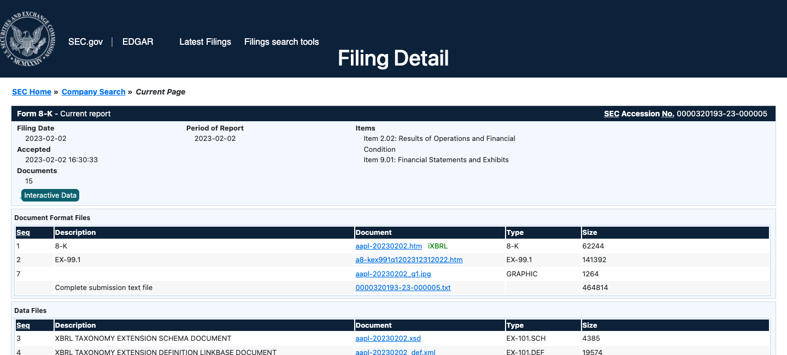
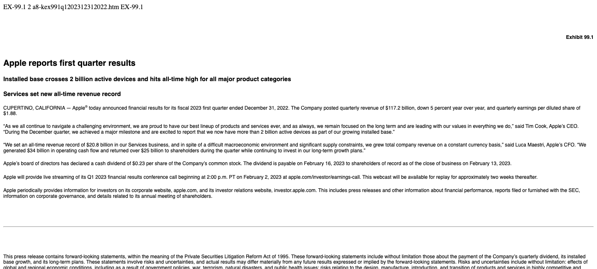
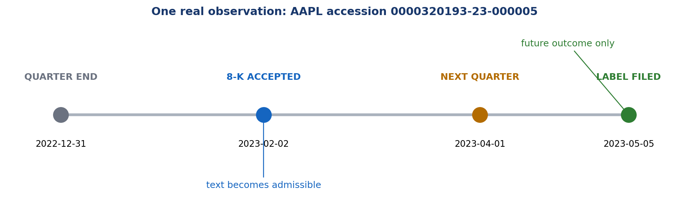
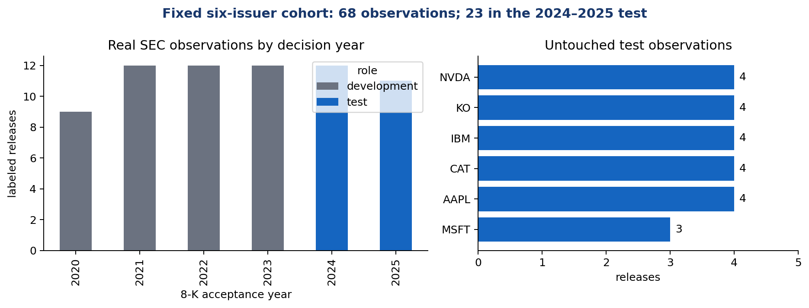
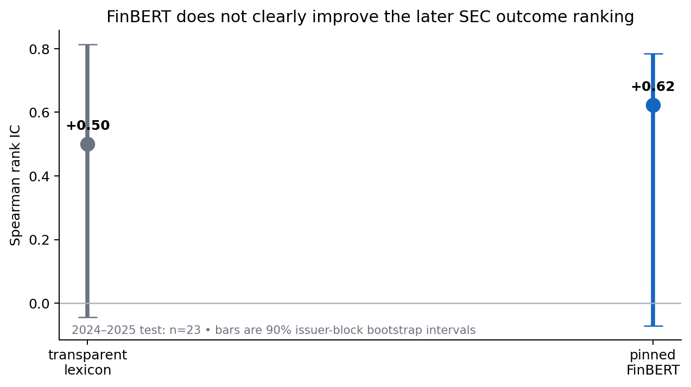
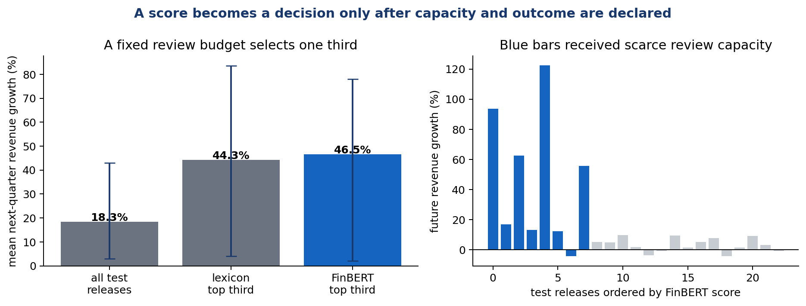

## Abstract {.unnumbered}

This study asks whether a pinned financial-language model adds useful ranking
information beyond a transparent word-count baseline. The feature documents are
68 real earnings-release exhibits furnished through SEC Form 8-K filings by six
large issuers from 2020 through 2025. Each release is timestamped at EDGAR
acceptance and paired with next-quarter year-over-year revenue growth calculated
from facts that became public in a later SEC filing. The first 45 observations
form development evidence; 23 releases accepted in 2024--2025 form the later
test. The lexicon records a test Spearman rank information coefficient of 0.501,
while pinned FinBERT records 0.624. Their paired difference is 0.122, but a 90
percent issuer-block bootstrap interval spans -0.351 to 0.553. A top-third review
policy also concentrates high-growth observations, but its evidence is small,
issuer-concentrated, and not a return or profit estimate. The warranted decision
is therefore to retain the transparent baseline while extending the population
and preserving a new later test. The project demonstrates how to join real SEC
documents, model scores, future labels, uncertainty, and decision authority
without converting a promising point estimate into an unsupported victory claim.

## Research question and decision

The question is deliberately comparative and allowed to fail:

> Does `ProsusAI/finbert`, pinned to revision
> `0bc2ac10dda6929bcb1f77ccc43c7ec5c424f031`, rank next-quarter
> year-over-year revenue growth better than a transparent lexicon on a later set
> of real SEC earnings releases?

The proposed use is analyst triage, not trading. If an analyst can inspect only
one third of new releases, the reader ranks which documents receive deeper
review. The design therefore evaluates both the continuous score and a fixed
top-third capacity rule. It does not claim that future revenue growth is directly
tradeable or that selected documents would produce excess returns.

## What the SEC records are

Form 8-K is a current report used for specified events under the Securities
Exchange Act [@sec_form_8k]. In the observations selected here, Item 2.02 reports
results of operations and financial condition, while Item 9.01 identifies the
attached exhibits. Exhibit 99.1 is the earnings release converted to plain text
and scored. The 8-K filing-detail page is therefore the folder and index; the
exhibit is the document the model reads.

The Apple observation used throughout the course makes the objects concrete.
EDGAR accession 0000320193-23-000005 was accepted on February 2, 2023 at
16:30:33 Eastern time. Its filing-detail page lists Item 2.02 and links Exhibit
99.1 [@sec_apple_8k_2023]. The exhibit reports Apple's quarter ended December
31, 2022, including quarterly revenue of $117.2 billion and the accompanying
management language [@sec_apple_exhibit_2023].

{#fig-sec-index width=100%}

{#fig-sec-exhibit width=100%}

The future outcome is a different object. The downloader obtains structured XBRL
revenue facts from a later SEC filing, selects the next fiscal quarter and its
same-quarter prior-year comparison, and computes year-over-year growth. XBRL
facts include a concept, value, unit, period, and filing provenance. They are used
as later labels; they are not included in the text supplied to FinBERT.

## Population, clocks, and provenance

The fixed teaching cohort contains Apple, Microsoft, NVIDIA, Caterpillar,
Coca-Cola, and IBM. The downloader selects original Form 8-K Item 2.02
earnings-release exhibits accepted during 2020--2025. An observation survives
only if a later filing supplies a clean quarterly revenue duration fact and a
same-filing prior-year comparison. Fourth-quarter values that would require
annual-minus-nine-month derivations are excluded.

Every row retains the issuer CIK, 8-K accession, EDGAR acceptance time, selected
exhibit filename and URL, content hash, outcome quarter, later label date, and
later filing accession. These fields make the information contract inspectable.

{#fig-clock width=100%}

Figure @fig-clock separates three dates that are easy to confuse. The quarter
end describes the business period. The 8-K acceptance time bounds when the
release text became public. The later filing date bounds when the future outcome
became observable. Aligning text to quarter end would move language backward in
time. Using the later revenue fact as a feature would directly reveal the label.

The cohort is small by design. Forty-five observations accepted through 2023
serve development and illustration; 23 observations accepted in 2024--2025 form
the untouched later comparison. This fixed six-issuer sample improves
inspectability but limits external validity.

{#fig-cohort width=90%}

## Readers and frozen procedure

The transparent baseline counts a printed set of positive and negative finance
terms and divides their difference by the total number of positive and negative
hits. Finance-domain dictionaries are important because words can carry meanings
in financial reports that differ from ordinary language [@loughran_mcdonald_2011].
The small baseline used here is intentionally simpler than a production
Loughran--McDonald implementation; its vocabulary is visible in `analysis.py`.

The candidate is FinBERT, a BERT model adapted to financial sentiment
classification [@araci_2019]. The checkpoint is pinned by revision rather than
named only by repository. Each complete release is tokenized, and at most eight
evenly spaced windows of 480 tokens are scored. Class probabilities are averaged
across windows, and the document score is positive probability minus negative
probability. This aggregation is part of the model specification.

Neither reader was trained here to predict next-quarter revenue growth. The
experiment therefore tests whether a sentiment representation supplies useful
downstream ordering, not whether FinBERT is an accurate revenue model.

## Evaluation and uncertainty

The primary metric is Spearman rank information coefficient: the correlation
between the ordering induced by a reader and the ordering of later revenue
growth. Rank IC is suitable for the triage question because the policy allocates
scarce review capacity by rank. It is not a return measure.

Uncertainty is estimated with 2,000 paired issuer-block bootstrap resamples using
seed 20261122. An issuer is the resampling unit, and all of its test observations
move together. The same resampled issuers are used for both readers so the
incremental difference is paired. The interval does not repair the small number
of issuers; it makes that uncertainty visible without pretending that 23 rows are
23 independent companies.

## Results

The lexicon test rank IC is 0.501, and FinBERT's is 0.624. Those point estimates
favor the richer reader. The relevant incremental estimate, however, is only
0.122, with a 90 percent paired interval from -0.351 to 0.553.

{#fig-comparison width=75%}

The interval includes both a substantial reversal and a large improvement.
Accordingly, the result supports continued investigation, not replacement of the
baseline.

The top-third policy converts the score into a visible use. All test observations
average 18.3 percent next-quarter year-over-year revenue growth. The eight
FinBERT-selected observations average 46.5 percent, and the lexicon-selected
observations average 44.3 percent. Those means are influenced by unusually high
NVIDIA growth quarters and carry wide issuer-block intervals.

{#fig-policy width=100%}

The figure evaluates allocation of analyst attention. It supplies no stock
return, portfolio, turnover, transaction cost, or market-capacity evidence.

## Decision, robustness, and limitations

The current evidence supports three statements: both readers rank this small
later cohort positively; a top-third review rule can be evaluated; and the
candidate is worth testing on a broader population. It does not establish a
stable incremental FinBERT advantage, a market-wide relationship, or a trading
claim.

The operating decision is therefore conservative: keep the transparent reader,
expand the issuer population, predeclare any revised text aggregation or outcome
definition, and reserve a genuinely new later period for the next comparison.

The study has material limitations. Six surviving large issuers are not a market
universe. Twenty-three test releases provide weak precision. The baseline is
small. Revenue growth is only one downstream outcome. The bootstrap represents
issuer concentration but not every source of time-series or model uncertainty.
The project is historical teaching evidence rather than a preregistered study,
and it does not estimate economic profits.

## Reproducibility and the two report pathways

The root-level `download_sec_data.py` recreates the SEC ledger and records source
URLs and SHA-256 hashes. `analysis.py --score-finbert` recreates model scores with
the pinned checkpoint; the committed score ledger supports a lightweight offline
run. `summary.json` contains the reported metrics, while `RESEARCH_RECORD.md`
states the clock, split, decision, and limits.

Pathway 1 is an integrated notebook in
`pathway1_integrated_notebook/analysis.ipynb`. Pathway 2 consists of the concise
analysis notebook beside this paper. Both call the same root-level pipeline and
must produce the same evidence. The separate paper may improve explanation; it
may not reopen model selection after the final test is visible.

## Conclusion

The empirical point estimate favors FinBERT, but the evidence does not establish
that the richer reader improves reliably on a transparent word-count baseline.
That bounded negative conclusion is the useful result. The project shows what
the actual SEC data are, which document the model reads, when the feature and
label become public, how uncertainty changes the sentence, and why a model's
authority should not exceed the population and decision that were tested.

## References {.unnumbered}

::: {#refs}
:::
