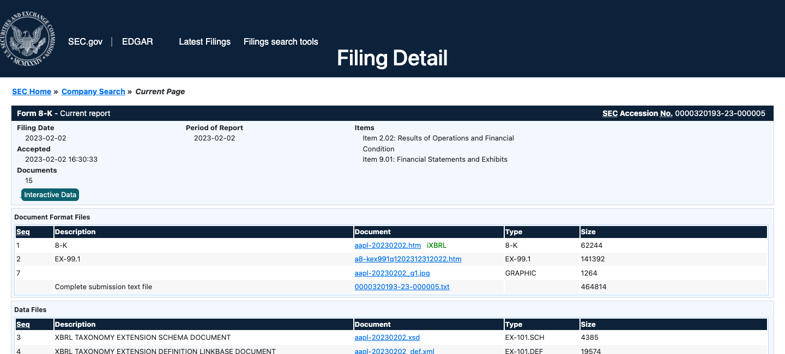
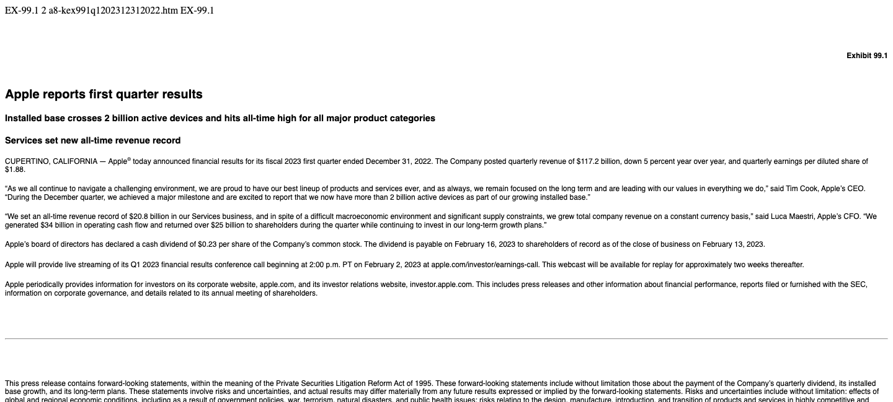
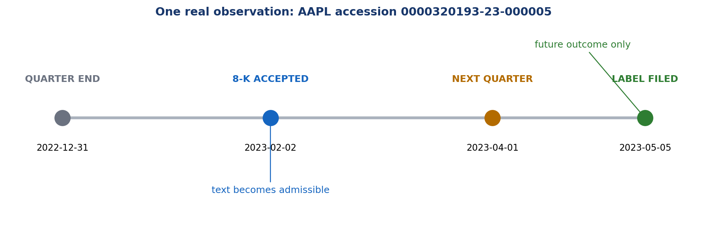
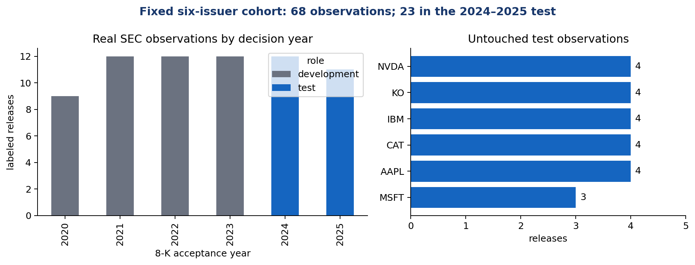
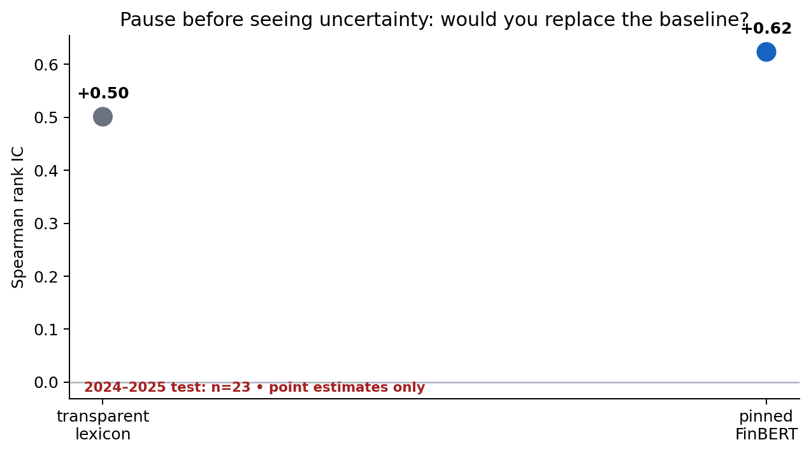
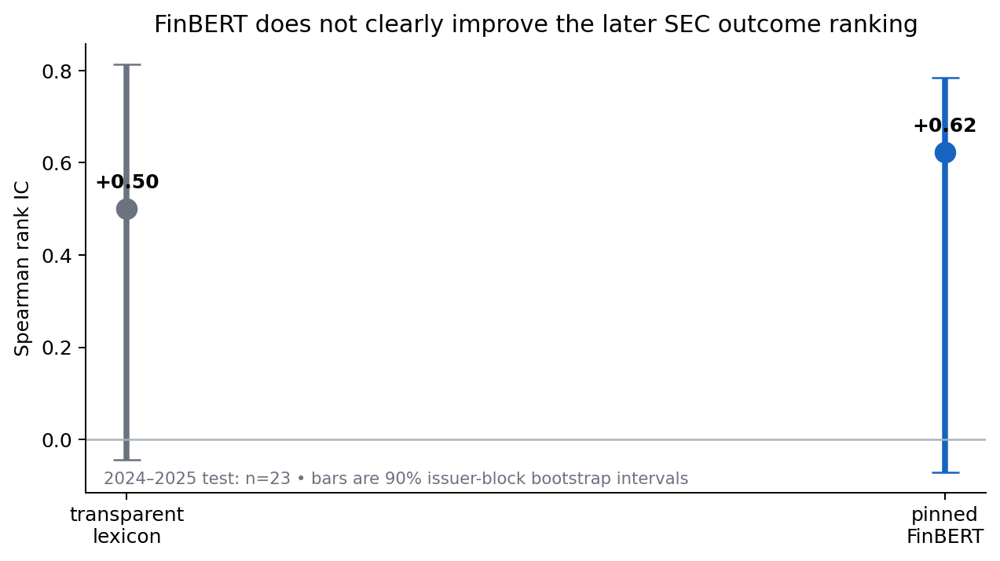
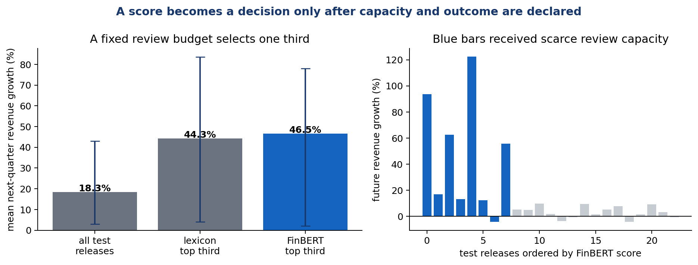

## One question that can lose

> Does pinned FinBERT rank **next-quarter revenue growth** better than a
> transparent lexicon on a later set of real U.S. Securities and Exchange
> Commission (SEC) earnings releases?

**Decision:** with capacity to inspect one third of releases, decide which receive
deeper analyst review.

## The evidence is real; the authority is bounded

| Object | Declared construction |
|---|---|
| population | AAPL, MSFT, NVDA, CAT, KO, IBM |
| feature | selected EX-99 earnings-release exhibit |
| clock | SEC EDGAR acceptance timestamp |
| outcome | next-quarter year-over-year revenue growth |
| role | analyst triage, not trading |

Six large issuers are a teaching cohort, not a market universe.

## What an 8-K contributes

An **8-K** is a current report for specified events [@sec_form_8k].

| Filing object | Role in this project |
|---|---|
| Item 2.02 | identifies results of operations and financial condition |
| Item 9.01 | lists financial statements and exhibits |
| Exhibit 99.1 | the earnings-release text supplied to both readers |

The filing page is the folder and index; the exhibit is the document the model reads.

## One actual SEC filing

{width=96% fig-align="center" fig-alt="SEC EDGAR filing-detail page for Apple's February 2, 2023 Form 8-K."}

Accepted **2023-02-02 16:30:33 ET** · Item **2.02** · Exhibit **99.1**

## The selected source document

{width=96% fig-align="center" fig-alt="Apple Exhibit 99.1 earnings release selected as the text feature."}

The later XBRL revenue fact is a label—not text shown to FinBERT.

## One observation has two clocks

{width=96% fig-align="center" fig-alt="A real Apple observation moves from quarter end to 8-K acceptance, next quarter end, and later XBRL label filing."}[^clock]

[^clock]: Empirical SEC record. Accession, acceptance time, exhibit URL and SHA-256, XBRL accession, quarter end, and later label date are stored in `data/derived/sec_events.csv`. EDGAR acceptance is an earliest-public-time bound.

## Pause: audit the clock

1. When may the text enter the feature?
2. When does the outcome become observable?
3. What would leak if we aligned the filing to quarter end?

**Do not continue until you can point to both clocks.**

## The test is later, small, and concentrated

{width=92% fig-align="center" fig-alt="The fixed cohort has 68 real SEC observations, 45 in development and 23 in a 2024-to-2025 later test, with three or four test observations per issuer."}[^cohort]

[^cohort]: Original Item 2.02 8-K earnings releases accepted during 2020–2025. Quarterly revenue labels require a later 10-Q duration fact and a same-filing prior-year comparative. Q4 derivations are excluded. Test begins 2024-01-01.

## The baseline and candidate do different amounts of work

| Reader | Construction |
|---|---|
| transparent baseline | fixed positive-minus-negative word counts |
| pinned FinBERT | `ProsusAI/finbert`, revision `0bc2ac10…` |
| document rule | mean probabilities over ≤8 evenly spaced 480-token windows |

The checkpoint name alone would not reproduce the score.

## The later comparison uses one primary metric

**Primary:** Spearman rank information coefficient (IC) with next-quarter
year-over-year revenue growth.

**Uncertainty:** 2,000 issuer-block bootstrap resamples; 90% percentile intervals.

**Why blocks?** Releases from the same issuer are not treated as unrelated companies.

## Pause: are point estimates enough?

{width=70% fig-align="center" fig-alt="Point estimates show test rank IC of 0.50 for the lexicon and 0.62 for FinBERT, with uncertainty intentionally hidden."}[^points]

Would you replace the cheap reader now? What number is still missing?

[^points]: Empirical 2024–2025 test point estimates, 23 releases. This pause intentionally withholds uncertainty; it is not the final evidentiary figure.

## Reveal: the incremental advantage is not established

{width=72% fig-align="center" fig-alt="Lexicon and FinBERT rank IC point estimates have wide 90 percent issuer-block bootstrap intervals that both cross zero."}[^comparison]

Paired FinBERT-minus-lexicon IC: **+0.12**, 90% interval **−0.35 to +0.55**.

[^comparison]: Same 23-release test. Bars are 90% percentile intervals from 2,000 issuer-block bootstrap resamples with seed 20261122. The paired interval uses the same resampled issuer draws for both readers.

## A score becomes a capacity decision

{width=95% fig-align="center" fig-alt="The left panel compares all test releases with the top thirds selected by each reader, including wide bootstrap intervals. The right panel shows every future outcome ordered by FinBERT score and highlights the selected third."}[^policy]

[^policy]: Top-third cut is recomputed inside each of 2,000 issuer-block resamples. Bars report mean next-quarter revenue growth. This is a review-capacity illustration, not a return or profit estimate.

## Why the 46.5% bar is not a victory

- only **8** FinBERT-selected test observations;
- unusually high NVIDIA growth quarters influence the mean;
- the lexicon-selected mean is **44.3%**;
- both selection intervals are wide;
- no result estimates returns, costs, or market capacity.

The decision figure narrows the claim; it does not create more evidence.

## The result can be negative and still useful

**Supported:** both readers rank this small later cohort positively.

**Not supported:** FinBERT has a stable incremental advantage over the lexicon.

**Decision:** keep the transparent reader until a broader population and a genuinely
new later test justify changing the workflow.

## The 14-slide story

1. question and decision
2. population and source
3. information clock
4. feature construction
5. baseline and candidate
6. test boundary
7. primary metric
8. point-estimate pause
9. uncertainty reveal
10. capacity policy
11. sensitivity and concentration
12. limitations
13. bounded conclusion
14. artifact ledger

## Every claim points to an artifact

| Claim | Artifact |
|---|---|
| source and clock | `sec_events.csv` + download script |
| model identity | `scored_events.model.json` |
| reported numbers | `summary.json` |
| figures | `analysis.py` |
| limitations and authority | `RESEARCH_RECORD.md` |

The audience can inspect the claim without trusting the slide author.
